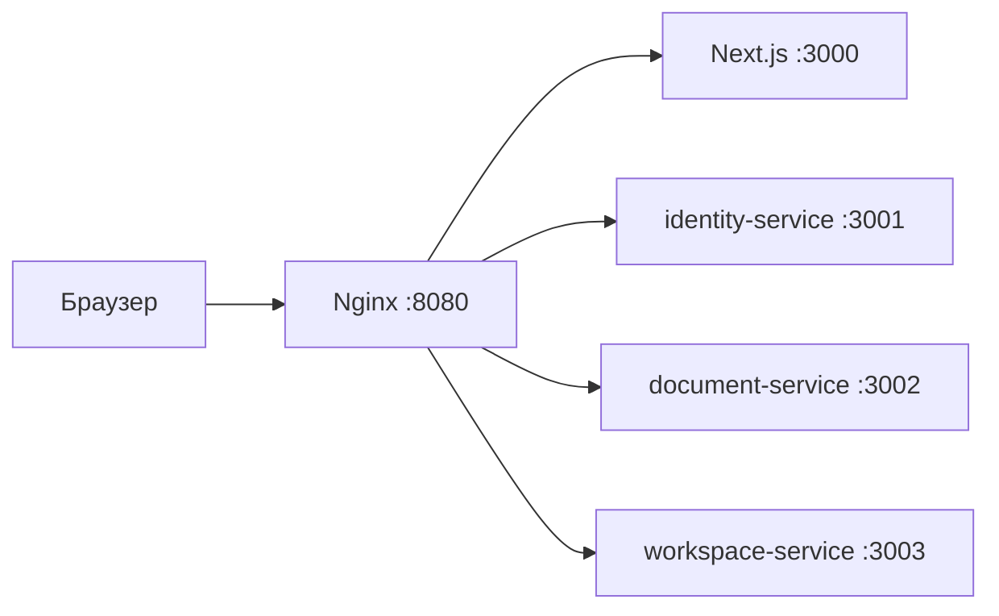

# Архитектура проекта

[← Документация](README.md) · [Далее: сервисы →](../services/README.md)

## Структура репозитория

```text
frameflow/
├── apps/frontend/               Next.js frontend
├── services/
│   ├── identity-service/        NestJS
│   ├── document-service/        NestJS
│   ├── workspace-service/       NestJS
│   ├── ai-service/              Python / FastAPI
│   └── Dockerfile               Общая сборка NestJS
├── packages/contracts/proto/    Место для protobuf-контрактов
├── infra/
│   ├── nginx/                   HTTP reverse proxy
│   ├── postgres/init/           Инициализация БД и ролей
│   └── minio/                   Сборка и инициализация S3
├── docs/                        Документация
├── compose.yaml                 Базовое окружение
├── compose.dev.yaml             NestJS watch-режим
├── pnpm-workspace.yaml
└── .env.example
```

## Ответственность сервисов

Границы ниже описывают целевую архитектуру продукта.

| Сервис | Планируемая ответственность |
| --- | --- |
| `identity-service` | Учётные записи, организации, членство и роли |
| `document-service` | Исходные документы, страницы, области, задания и источники |
| `workspace-service` | Таблицы, колонки, заготовки полей, шаблоны, записи, проверка, связи и экспорт |
| `ai-service` | Подготовка изображений, OCR, NER, координаты, нормализация, summary и ответы |

Каждый NestJS-сервис — отдельное приложение с собственными зависимостями и образом. pnpm workspace объединяет их в одном репозитории. Общий Dockerfile выбирает приложение через `SERVICE_NAME`.

## Внутренние слои

```text
src/
├── main.ts
├── app.module.ts
└── modules/<name>/
    ├── <name>.module.ts
    ├── application/
    ├── domain/entities/
    ├── infrastructure/migrations/
    └── presentation/dto/
```

Используется слоистая архитектура. `presentation` принимает запросы, `application` координирует сценарии, `domain` хранит предметные модели и правила, `infrastructure` содержит адаптеры к хранилищам и внешним системам. `AppModule` подключает модули сервиса, а каждый модуль регистрирует контроллеры и providers.

Прямые импорты внутренних классов соседнего сервиса не используются; общение должно идти через контракты. Каждый сервис владеет своими данными и миграциями.

## HTTP и gRPC

HTTP-путь:



Отдельного API Gateway/BFF нет. Nginx удаляет внешний префикс `/v1/<service>` и передаёт оставшийся путь сервису. Nginx не выполняет бизнес-авторизацию и не переводит HTTP/JSON в gRPC.

gRPC предназначен для внутренних вызовов. Настройки `GRPC_PORT` и `*_GRPC_URL` резервируют порты 50051–50054; для обслуживания запросов требуются отдельные server transports и protobuf-контракты.

## Frontend и AI

Frontend: React, Next.js App Router, TypeScript, Ant Design, Zustand, Zod, Tailwind CSS, PDF.js и Xior. Маршруты и страницы находятся в `src/app` (App Router); остальные слои — `widgets`, `features`, `entities`, `shared`.

AI сохраняет Python 3.13 / FastAPI / grpcio. В `src/frameflow_ai/modules/processing/` используются четыре слоя. PaddleOCR и XLM-RoBERTa — кандидаты для основного пайплайна.

## Хранилища

В Compose используется один PostgreSQL с отдельными БД и владельцами сервисов, Redis с паролем/AOF и приватный MinIO. Общий сервер PostgreSQL не даёт сервисам право читать или изменять чужие таблицы напрямую.
