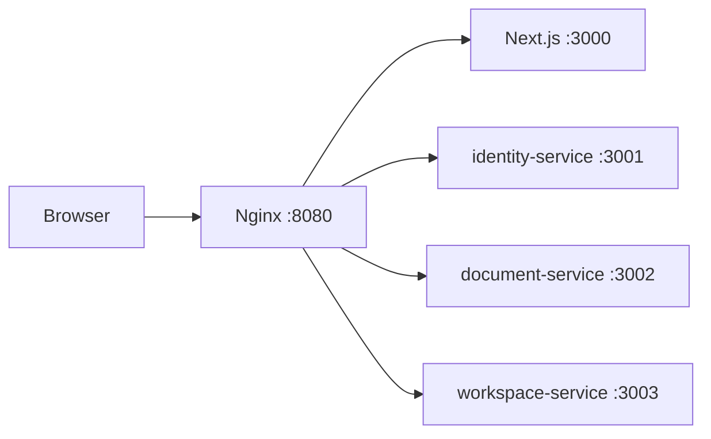

# Project architecture

[← Documentation](README.md) · [Next: Services →](../services/README.md)

## Repository layout

```text
frameflow/
├── apps/frontend/               Next.js frontend
├── services/
│   ├── identity-service/        NestJS
│   ├── document-service/        NestJS
│   ├── workspace-service/       NestJS
│   ├── ai-service/              Python / FastAPI
│   └── Dockerfile               Shared NestJS build
├── packages/contracts/proto/    Protocol Buffer contracts
├── infra/
│   ├── nginx/                   HTTP reverse proxy
│   ├── postgres/init/           Database and role initialization
│   └── minio/                   S3 build and initialization
├── docs/                        Documentation
├── compose.yaml                 Base environment
├── compose.dev.yaml             NestJS watch mode
├── pnpm-workspace.yaml
└── .env.example
```

## Service responsibilities

These boundaries describe the target product architecture.

| Service | Intended responsibility |
| --- | --- |
| `identity-service` | User accounts, organizations, memberships, and roles |
| `document-service` | Source documents, pages, regions, jobs, and provenance |
| `workspace-service` | Tables, columns, field presets, templates, records, review, relationships, and exports |
| `ai-service` | Image preparation, OCR, NER, coordinates, normalization, summaries, and answers |

Each NestJS service is a separate application with its own dependencies and image. A pnpm workspace keeps them in one repository. The shared Dockerfile selects an application through `SERVICE_NAME`.

## Internal layers

```text
src/
├── main.ts
├── app.module.ts
└── modules/<name>/
    ├── <name>.module.ts
    ├── application/
    ├── domain/entities/
    ├── infrastructure/migrations/
    └── presentation/dto/
```

The project uses layered architecture. `presentation` accepts requests, `application` coordinates use cases, `domain` contains business models and rules, and `infrastructure` holds adapters for storage and external systems. `AppModule` imports service modules, and each module registers its controllers and providers.

Services communicate through contracts rather than importing one another's internal classes. Each service owns its data and migrations.

## HTTP and gRPC

HTTP routing:



There is no separate API Gateway/BFF. Nginx strips the public `/v1/<service>` prefix and forwards the remaining path to the service. Nginx does not implement business authorization or translate HTTP/JSON into gRPC.

gRPC is intended for internal calls. `GRPC_PORT` and `*_GRPC_URL` settings reserve ports 50051–50054; serving requests requires server transports and Protocol Buffer contracts.

## Frontend and AI

Frontend technologies: React, Next.js App Router, TypeScript, Ant Design, Zustand, Zod, Tailwind CSS, PDF.js, and Xior. Routes and pages belong in `src/app`; the other layers are `widgets`, `features`, `entities`, and `shared`.

AI uses Python 3.13 / FastAPI / grpcio. Its four layers live in `src/frameflow_ai/modules/processing/`. PaddleOCR and XLM-RoBERTa are candidates for the core extraction pipeline.

## Storage

Compose uses one PostgreSQL instance with separate databases and owners per service, Redis with authentication and AOF persistence, and private MinIO storage. Sharing a PostgreSQL server does not permit services to read or modify one another's tables directly.
